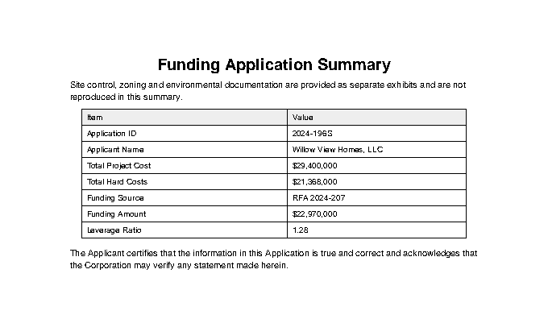
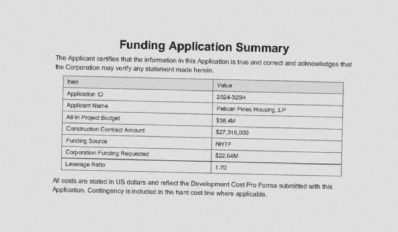

# PDF Data Extractor

Pull the key numbers out of funding-application PDFs, including scanned ones, and say which values
not to trust. Rules extract what they can, an LLM fills the gaps (reading page images when a page
is a scan), every value gets a confidence score and a pointer to its page and position, and
anything doubtful goes to a human-review screen.

The target is affordable-housing funding applications in the style published by the Florida
Housing Finance Corporation (FHFC). A built-in synthetic benchmark, with a development set and a
separate held-out set of 40 documents each (12 of them scanned), measures how well each approach
works and where it breaks.

**Headline (held-out set):** on scanned PDFs, accuracy rises from 37% with rules + OCR to 96% when
the LLM reads the page image, and no wrong value passes without being flagged.

| Native PDF | Heavy scan (no text layer) |
|:---:|:---:|
|  |  |

## Why

Funding documents carry the numbers analysts need (development cost, construction cost, funding
source, leverage), but they arrive as PDFs: some typed, some tables, some photocopies. Copying them
by hand is slow and error-prone. Fully automatic extraction is fast but silently wrong some of the
time, which is worse for financial data. The useful product is extraction that **knows where it is
unsure**, so people only check the values that need checking.

Scans matter most. A scanned page has no text at all, only pixels, so text rules see nothing and
OCR introduces its own errors ('$17,775,000' read as '$1 7,775,000'). That is exactly where manual
copying is slowest, and where the choice of method changes the result the most.

## Results

Held-out set: 40 synthetic documents (12 scanned), 280 labelled fields, generated after the system
was built and never used to tune it. LLM: Gemini 3.5 Flash Lite (`gemini-3.5-flash-lite`, free
tier), temperature 0. About 50 API calls per set.

| Metric | Rules + OCR | + LLM on text | + LLM on page images |
|:---|---:|---:|---:|
| Field accuracy, all documents | 62% | 90% | **98%** |
| Accuracy, native PDFs | 73% | 98% | 98% |
| Accuracy, scanned PDFs | 37% | 69% | **96%** |
| Accuracy, heavy scans | 21% | 50% | **93%** |
| Accuracy, narrative layout | 7% | 98% | 98% |
| Accuracy, unseen labels | 41% | 93% | 93% |
| Error rate of values NOT flagged | 0% | 2.4% | **0%** |
| Review rate (values sent to a person) | 23% | 15% | 23% |

The development set (seed 7) tells the same story: scanned accuracy 30% / 71% / 99% and overall
57% / 91% / 99% for the three columns.

What the numbers say:

1. **On scans, the image is what matters.** Giving the LLM the OCR text lifts scanned accuracy from
   37% to 69%; giving it the page image lifts it to 96% (heavy scans: 21% → 50% → 93%). On native
   PDFs the two LLM routes are identical (98%), as they should be: the text there is already exact.
2. **Two readers of the same OCR text are not two opinions.** In the text run, five wrong values
   passed unflagged, all on scans. The LLM read misread OCR text and either repeated it on its own
   ('2025-1288' for '2025-128S') or agreed with the rules reading the same text ('EL! Loan' for
   'ELI Loan'). When the LLM reads the image instead, it disagrees with the bad OCR: every wrong value
   it returns is flagged, and the three it misses show up as missing.
3. **The cost is review volume, not accuracy.** The image run sends 23% of values (62) to a person,
   and about 95% of those turn out to be right. Of the 62: 28 were read only from a scan image, with
   no text layer to check the quote against; 20 are OCR values the LLM was not asked to confirm;
   12 are the deliberate leverage inconsistencies, flagged as intended; 2 are disagreements.
   Lowering the first two groups is the main thing left to do.
4. **The rules earn their place on native documents only as a cheap first pass.** Rules alone get
   73% of native fields and are never wrong when they let a value through; the LLM covers what they
   miss (narrative text 7% → 98%, unseen labels 41% → 93%).

How to read it:

- **Accuracy** counts a field as right when the value matches the gold label (money and ratios
  within 1%). A field the document does not state counts as right only if the system returns
  nothing.
- **Error rate of values NOT flagged** is the number that matters for trust: how often a value
  that was *not* sent for review is wrong. **Review rate** is the cost: how much a person still
  has to check.
- These are synthetic documents. They test known difficulties on purpose, but they are cleaner and
  more uniform than real filings (one font, no stamps or handwriting), so treat the numbers as a
  comparison between methods, not as the accuracy you would get on real FHFC documents.

## How it works

```
 PDF ─► parse (pdfplumber: text, word boxes, table cells)
          │  page has no text layer? ─► OCR (Tesseract)            [scanned pages]
          ▼
       rules: label regex + table headers ─► candidates with page + bounding box
          ▼
       LLM, only for fields the rules missed or that are free text
          │  text backend: sees the relevant pages' text
          │  vision backend (Gemini): also sees scanned pages as images
          │  must return JSON + a verbatim quote, checked against the page
          ▼
       confidence per field: rule/LLM agreement, format checks, cross-field checks
          ▼
       records.csv / extraction.xlsx, audit_log.csv, review_queue.csv, Streamlit review screen
```

| Module | Job |
|:---|:---|
| `parse.py` | Text, word boxes and table cells per page; OCR fallback for scanned pages |
| `rules.py` | Label and table-header matching, money / ratio / id normalisers |
| `llm_extract.py` | Backends (Gemini, Ollama, Groq, Mistral), page images for scans, evidence check, retries, disk cache |
| `confidence.py` | Per-field score and the review decision |
| `export.py` | CSV / Excel, audit log, review queue, human edits |
| `synth.py` | The synthetic benchmark generator |
| `evaluate.py` | Accuracy, coverage, flag quality, per-segment breakdown |
| `cli.py` | `synth`, `extract`, `evaluate`, `compare` |

## The benchmark

`make benchmark` writes two sets of 40 PDFs with a gold label for each: a development set
(`eval/synthetic/`, seed 7) used while building, and a held-out set (`eval/holdout/`, seed 23)
used only to report results. The same seed gives byte-identical files; the gold labels are
committed and the PDFs regenerated.

- **Five layouts**, eight documents each: label-value form, two-column table, one-row table with
  field headers, narrative paragraph (values inside sentences), and a three-page document with the
  fields spread among boilerplate.
- **Scanned slice (30%)**: 12 documents are rasterised and degraded (skew, blur, speckle, grey
  cast, JPEG compression) and saved with **no text layer**. Six are light scans, six heavy. They
  are spread across all five layouts, so scan quality is not confused with layout difficulty.
- **Traps**, each tagged in the gold file so results can be broken down by them:
  - *per-unit distractor*: 'Total Development Cost per Unit' printed next to the real total;
  - *unseen labels*: realistic synonyms the rules were never given ('Total Development Budget',
    'Borrowing Entity');
  - *short money*: '$14.5M' instead of '$14,500,000';
  - *no funding amount*: optional fields absent, so the right answer is "nothing";
  - *inconsistent leverage*: the stated leverage disagrees with cost / funding; the gold value is
    what the page says, and a good system should send it for review.

Why synthetic: FHFC publishes most cost data as Excel pro formas, so a hand-labelled PDF set is
slow to build and small. A generator gives a labelled set in seconds, with hard cases chosen on
purpose. It does not replace real documents; see "Your own documents" below.

## Design decisions and trade-offs

- **Rules before the LLM.** Labelled numbers in tables are found reliably and for free by rules.
  The LLM is slower, costs tokens and can invent values, so it runs second, on fewer fields and
  fewer pages, and disagreement between the two becomes a confidence signal.
- **Exact label matching.** 'Total Development Cost per Unit' must not be read as the total, so
  labels match exactly after cleaning. The cost is recall on unseen wording, which the benchmark
  measures directly (the *unseen labels* trap).
- **Images only for scanned pages.** Native pages already have perfect text, so sending their
  images would add cost without adding information. Scanned pages go to a vision model as images,
  with any OCR text alongside.
- **The LLM must quote its evidence.** On native text the quote must appear on the cited page. OCR
  text is noisy, so on OCR pages a quote counts when 80% of its words appear. A value read only
  from an image with no text to check it against stays unverified and goes to review.
- **OCR values need a second reader.** OCR misreads characters in ways no format check catches
  ('2024-210S' read as '2024-2108' in the development set). A rule value read from OCR text loses
  0.20 confidence, which sends it to review unless the LLM independently reads the same value.
- **When rules and LLM disagree, the field goes to review.** The rule value is kept unless it fails
  a format check the LLM value passes (for example OCR producing '$1'), in which case the LLM value
  is shown to the reviewer.
- **Confidence is a readable rule table, not a model.** With 40 documents there is not enough data
  to fit a calibrated score. The scores are hand-set, the evaluation measures whether they work,
  and `ConfidenceConfig` is where to tune them. A verified LLM-only value on native text is trusted
  (0.75); the same value with only a fuzzy OCR match is not (0.60).
- **Cheap to re-run.** Hosted calls retry on rate limits with backoff, can be spaced out for free
  tiers (`LLM_MIN_INTERVAL_S`), and every response is cached on disk, so re-running an evaluation
  costs no API calls.
- **Leverage ratio is total development cost / funding amount.** Programmes define leverage
  differently; the cross-check (5% tolerance) lives in `confidence.py`.
- **One record per document.** Fits individual applications. Funding reports with many
  applications in one table need a multi-record mode (see next steps).

## How to run

Full step-by-step guide, including getting a free Gemini key: [RUNNING.md](RUNNING.md).

```bash
make install          # uv sync with dev, app and OCR extras (also: brew install tesseract)
make test             # offline tests, no key needed
make benchmark        # development + held-out sets, 40 PDFs each, with gold labels
make compare-rules    # rules + OCR only on the development set, no key needed
cp .env.example .env  # set LLM_BACKEND=gemini and GEMINI_API_KEY
make compare          # rules vs LLM on text vs LLM on page images, development set
make holdout          # the same three runs on the held-out set: the numbers to report
make app              # review screen at http://localhost:8501
```

## Tried and dropped

Before adding the LLM, I tried to lift rules + OCR accuracy on scans directly: rebuilding table rows
from OCR word positions, straightening the page, erasing table lines and cleaning the image. Rebuilding
rows looked like +6 points on the development scans but only +2 on a held-out set, and every variant
produced more confidently wrong values (unflagged error 4% → 7-12%). Tesseract simply cannot read
7.5pt table text on a heavy scan; no post-processing fixes characters it never saw. That result is
why the effort went into the vision route and the OCR confidence penalty instead.

One bug did come out of checking the held-out set: a table header with one known label and several
unfamiliar ones was read as label-value pairs, so a header cell became a value. It is fixed for all
tables (`_looks_like_header` in `rules.py`), and the held-out seed was then changed so the reported
set is one nothing was fixed against.

## Your own documents

Put public PDFs in `data/pdfs/` (not committed). For each one, copy
`eval/gold/TEMPLATE_application.json`, set `source_file`, and fill in the values you read in the
document (`null` if it does not state the field). Then `make evaluate`. Expect to add label
synonyms in `schemas.py` for a new document family; the *unseen labels* row in the benchmark shows
how much the LLM covers for that in the meantime.

## Tests

`make test` runs offline in seconds: no network, no LLM, no OCR. Covered: money and ratio parsing,
label and table matching, LLM response parsing and evidence checks (exact and OCR-tolerant) with a
`FakeLLM`, confidence scoring and disagreement handling, export and human edits, the benchmark
generator (deterministic to the byte, every gold value printed on the page, scans have no text
layer), header detection for tables with unfamiliar labels, OCR values held for review unless the
LLM agrees, page images sent only for scanned pages, the Gemini request format, retries on rate limits but not on
auth errors, the response cache, per-segment metrics and the `compare` command.

## Limitations and next steps

- **Cut the review load on scans.** With the `hard` policy the LLM is only asked about fields the
  rules missed, so OCR values it was never asked to confirm still go to review. Next: ask the vision
  model about every field on scanned pages, and when it disagrees with OCR, show its reading first
  (in two held-out cases it had the right answer while the OCR value was displayed). Values read
  only from an image could be confirmed by a second, independent read (another model or a re-ask
  at a different resolution) rather than by a person.
- **Evidence found in OCR text is weak evidence.** An LLM quote that matches OCR text exactly can
  still match a misread; OCR-page evidence should count as fuzzy, not exact.
- Three native table documents lost the applicant name in both LLM runs; worth inspecting the
  prompts and replies in `.cache/llm/`.
- Synthetic documents are cleaner than real filings: one font, no handwriting, no stamps. Next
  step: 10 hand-labelled real documents, reported separately.
- Confidence weights are hand-set; with enough labels, fit them (for example logistic regression on
  the reasons) and report calibration.
- Multi-record mode for funding reports with one row per application.
- Bounding boxes for LLM values come from searching for the value or quote, so a repeated value
  points to its first appearance, and values read only from an image have no box.
- Table detection uses pdfplumber defaults; borderless tables may come out as plain text.

## What changed from v1

v1 was a chat-with-your-PDF prototype (LangChain retrieval with Flan-T5 in Streamlit). It answered
questions about a document but did not produce a table, score confidence or measure accuracy, and
its on-screen metrics were placeholders. v2 rebuilt it around extraction you can check: rules
first, LLM second, per-field confidence, an audit trail, a review screen, a labelled benchmark with
scanned documents, and a vision route for scans.

## License

MIT, see [LICENSE](LICENSE). The benchmark documents are generated; all names and numbers in them
are invented.
